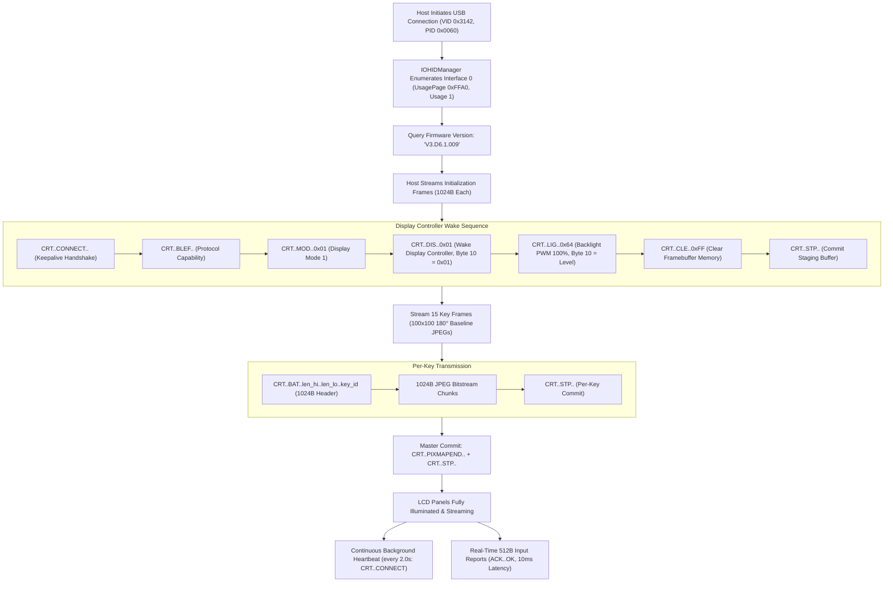

# fifine-ampligame-d6: Standalone macOS Driver & Bitfocus Companion Integration

[](LICENSE)
[](https://www.python.org/)
[](#hardware-identification--usb-descriptor)
[-success.svg)](#requirements--installation)

A 100% standalone, pure Python native USB driver, LCD graphics engine, and zero-configuration **Bitfocus Companion Satellite bridge** for the **Fifine AmpliGame D6** (HotSpot / MiraBox StreamDock D6 & D6-Pro 15-key LCD deck) on macOS.

**NO proprietary vendor software. NO background daemons. ZERO binary dependencies. ZERO root/sudo privileges.**  
Direct, low-level USB communication with sub-10ms hardware latency, full per-key 100×100 LCD tile rendering, and seamless two-way Bitfocus Companion show automation.

---

## Table of Contents
1. [Bitfocus Companion Integration (Satellite Bridge)](#1-bitfocus-companion-integration-satellite-bridge)
   - [Quickstart: Connect to Companion](#quickstart-connect-to-companion)
   - [Edge-to-Edge Bezel Crop & Zoom](#edge-to-edge-bezel-crop--zoom)
   - [Architecture Diagram](#companion-architecture)
2. [Standalone CLI Reference](#2-standalone-cli-reference)
3. [Python API Reference & Code Examples](#3-python-api-reference--code-examples)
   - [Basic Event Listeners (`@deck.on_press`, `@deck.on_release`)](#basic-event-listeners)
   - [Display Custom Icons & Dynamic Visual Press Feedback](#display-custom-icons--dynamic-visual-press-feedback)
   - [High-Level Action Automation (Media Keys & Shell Scripts)](#high-level-action-automation)
   - [Low-Level Driver & Framebuffer Access](#low-level-driver--framebuffer-access)
4. [Hardware Button Matrix & Layout Geometry](#4-hardware-button-matrix--layout-geometry)
5. [The Reverse Engineering Odyssey & Technical Post-Mortem](#5-the-reverse-engineering-odyssey--technical-post-mortem)
   - [Why All Prior Third-Party Drivers Failed](#why-all-prior-third-party-drivers-failed)
   - [Disassembly Walkthrough of `libSDLibrary.1.0.25.dylib`](#disassembly-walkthrough-of-libsdlibrary1025dylib)
   - [The Dead Code Trap: `ULEND` vs `PIXMAPEND` and `STP`](#the-dead-code-trap-ulend-vs-pixmapend-and-stp)
   - [The Display Wake Bit Mystery: `CRT DIS` Wire Offset 10](#the-display-wake-bit-mystery-crt-dis-wire-offset-10)
   - [The Inverted Panel Mounting & JPEG Decoder Engine](#the-inverted-panel-mounting--jpeg-decoder-engine)
   - [The Vertical Hardware Geometry & Panel Slot Alignment](#the-vertical-hardware-geometry--panel-slot-alignment)
6. [Hardware Identification & USB Descriptor](#6-hardware-identification--usb-descriptor)
   - [USB Endpoints & Report Descriptor Breakdown](#usb-endpoints--report-descriptor-breakdown)
7. [The Complete Wire Protocol Specification](#7-the-complete-wire-protocol-specification)
   - [Host-to-Device (1024-Byte Output Reports)](#host-to-device-1024-byte-output-reports)
   - [Device-to-Host (512-Byte Input Reports)](#device-to-host-512-byte-input-reports)
8. [Architecture & Concurrency Model](#8-architecture--concurrency-model)
   - [Dual-Thread HID Core (CFRunLoop Read Draining + Paced Writes)](#dual-thread-hid-core)
   - [Keepalive Heartbeat Watchdog](#keepalive-heartbeat-watchdog)
   - [Pure Native Platform Layer (macOS IOKit / CoreFoundation via ctypes)](#pure-native-platform-layer)
9. [Requirements & Installation](#9-requirements--installation)
10. [Repository Structure](#10-repository-structure)
11. [License](#11-license)

---

## 1. Bitfocus Companion Integration (Satellite Bridge)

Use your Fifine AmpliGame D6 as a 15-key control surface inside [Bitfocus Companion](https://bitfocus.io/companion) on macOS.

Because macOS security prevents userland virtual USB HID emulation without third-party kernel extensions, this project integrates via Bitfocus Companion's official **Satellite API** over a local loopback TCP connection (port 16622). To Companion, the Fifine D6 appears and functions identically to a native 15-key Stream Deck surface.

<a name="companion-architecture"></a>


### Quickstart: Connect to Companion

1. Open **Bitfocus Companion** (ensure the Satellite API is enabled in Companion settings, default port `16622`).
2. Run the bridge:
   ```bash
   python3 -m fifine.cli companion
   ```
   Or via the standalone example script:
   ```bash
   python3 examples/companion_satellite.py
   ```
3. Open the Companion Admin GUI (`http://127.0.0.1:8000`), navigate to the **Surfaces** tab, and confirm `"Fifine AmpliGame D6"` appears as an active 15-key grid.
4. Button labels, colors, and dynamic feedback (OBS streaming status, audio meters, timers) will immediately stream onto the Fifine LCD screens, and button presses trigger your Companion actions with sub-10ms response latency.

### Edge-to-Edge Bezel Crop & Zoom

Elgato Stream Decks feature physical curved plastic bezels that overlap the edges of the LCDs, so Companion renders button graphics with built-in margins. The Fifine AmpliGame D6 uses flat, clear acrylic keycaps with no bezel obstruction.

The bridge automatically applies an edge-to-edge bezel crop (`--zoom 1.18` by default) so button graphics and text expand completely across the entire 100×100 display without black borders. You can customize or disable this:

```bash
# Edge-to-edge fill (default zoom 1.18x)
fifine companion

# Custom zoom factor (e.g. 1.25x for tighter crop or 1.0x for uncropped 1:1)
fifine companion --zoom 1.25

# Specify custom Companion host, port, or brightness
fifine companion --host 127.0.0.1 --port 16622 --brightness 90 --zoom 1.18
```

---

## 2. Standalone CLI Reference

The package provides a command-line interface:

```bash
# Bridge Fifine D6 into Bitfocus Companion as a 15-key surface
fifine companion
# Or with fine-tuning options:
fifine companion --host 127.0.0.1 --port 16622 --brightness 100 --zoom 1.18 --size 100

# Wake deck, render default UI, and listen for events
fifine listen

# Inspect MCU firmware version and USB connectivity
fifine info

# Adjust backlight brightness (0 to 100)
fifine brightness 80

# Upload an image (PNG, JPG, BMP) to a specific button (1..15)
fifine set-image 1 /path/to/icon.png

# Clear all LCD screens to black
fifine clear
```

---

## 3. Python API Reference & Code Examples

### Basic Event Listeners

```python
from fifine import FifineDeck

deck = FifineDeck(auto_wake=True, default_brightness=100)

@deck.on_press
def handle_press(key: int):
    print(f"Key {key} pressed!")

@deck.on_release
def handle_release(key: int):
    print(f"Key {key} released!")

deck.start(blocking=True)
```

### Display Custom Icons & Dynamic Visual Press Feedback

```python
from fifine import FifineDeck

deck = FifineDeck()

# Set button icons from PNG/JPG files or solid colors
deck.set_key_image(1, "icons/mic_on.png")
deck.set_key_color(2, "#3b82f6")  # Solid blue tile

# Invert color when pressed
@deck.on_press
def on_press(key: int):
    deck.set_key_color(key, "#ffffff")

@deck.on_release
def on_release(key: int):
    deck.set_key_color(key, "#000000")

deck.start(blocking=True)
```

### High-Level Action Automation

```python
import subprocess
from fifine import FifineDeck

deck = FifineDeck()

@deck.on_press
def handle_action(key: int):
    if key == 1:
        # Toggle Microphone Mute
        subprocess.run(["osascript", "-e", "set volume input volume 0"])
    elif key == 2:
        # Play / Pause Spotify
        subprocess.run(["osascript", "-e", 'tell application "Spotify" to playpause'])
    elif key == 3:
        # Open Application
        subprocess.run(["open", "-a", "OBS"])

deck.start(blocking=True)
```

### Low-Level Driver & Framebuffer Access

```python
from fifine import FifineDriver, FifineDisplay

driver = FifineDriver()
display = FifineDisplay(driver, width=100, height=100)

driver.start(blocking=False)

# Direct display wake sequence
display.wake(brightness=100)

# Set solid RGB color on slot 3
display.set_key_color(3, (255, 128, 0))

driver.stop()
```

---

## 4. Hardware Button Matrix & Layout Geometry

The Fifine AmpliGame D6 features 15 mechanical tactile buttons with integrated full-color LCD screens arranged in a 3×5 grid:

```
┌──────────────┬──────────────┬──────────────┬──────────────┬──────────────┐
│    KEY 1     │    KEY 2     │    KEY 3     │    KEY 4     │    KEY 5     │
│ [Row 0, Col0]│ [Row 0, Col1]│ [Row 0, Col2]│ [Row 0, Col3]│ [Row 0, Col4]│
├──────────────┼──────────────┼──────────────┼──────────────┼──────────────┤
│    KEY 6     │    KEY 7     │    KEY 8     │    KEY 9     │    KEY 10    │
│ [Row 1, Col0]│ [Row 1, Col1]│ [Row 1, Col2]│ [Row 1, Col3]│ [Row 1, Col4]│
├──────────────┼──────────────┼──────────────┼──────────────┼──────────────┤
│    KEY 11    │    KEY 12    │    KEY 13    │    KEY 14    │    KEY 15    │
│ [Row 2, Col0]│ [Row 2, Col1]│ [Row 2, Col2]│ [Row 2, Col3]│ [Row 2, Col4]│
└──────────────┴──────────────┴──────────────┴──────────────┴──────────────┘
```

The physical hardware architecture exhibits an inverted display panel slot geometry relative to the top-to-bottom user layout:

- **Button Input Reports:** The MCU naturally reports `0x01..0x05` for the physical top row (Buttons 1..5), `0x06..0x0A` for the physical middle row (Buttons 6..10), and `0x0B..0x0F` for the physical bottom row (Buttons 11..15).
- **LCD Display Slots:** The internal LCD panel routing assigns slots `11..15` to the physical top row, `6..10` to the middle row, and `1..5` to the bottom row.

The driver transparently handles this through `logical_to_hardware_slot()` and `DEVICE_ID_TO_KEY`:

| Physical Key Position | Front Panel Label | Hardware Input ID (Hex) | Hardware LCD Slot | Driver Logical Key |
|:---:|:---:|:---:|:---:|:---:|
| **Row 0, Col 0 (Top-Left)** | Key 1  | `0x01` | 11 | 1 |
| **Row 0, Col 1** | Key 2  | `0x02` | 12 | 2 |
| **Row 0, Col 2** | Key 3  | `0x03` | 13 | 3 |
| **Row 0, Col 3** | Key 4  | `0x04` | 14 | 4 |
| **Row 0, Col 4 (Top-Right)** | Key 5  | `0x05` | 15 | 5 |
| **Row 1, Col 0 (Mid-Left)** | Key 6  | `0x06` | 6 | 6 |
| **Row 1, Col 1** | Key 7  | `0x07` | 7 | 7 |
| **Row 1, Col 2** | Key 8  | `0x08` | 8 | 8 |
| **Row 1, Col 3** | Key 9  | `0x09` | 9 | 9 |
| **Row 1, Col 4 (Mid-Right)** | Key 10 | `0x0A` | 10 | 10 |
| **Row 2, Col 0 (Bot-Left)** | Key 11 | `0x0B` | 1 | 11 |
| **Row 2, Col 1** | Key 12 | `0x0C` | 2 | 12 |
| **Row 2, Col 2** | Key 13 | `0x0D` | 3 | 13 |
| **Row 2, Col 3** | Key 14 | `0x0E` | 4 | 14 |
| **Row 2, Col 4 (Bot-Right)** | Key 15 | `0x0F` | 5 | 15 |

---

## 5. The Reverse Engineering Odyssey & Technical Post-Mortem

Prior to this implementation, no independent driver succeeded in unlocking the 15 integrated LCD screens on the Fifine AmpliGame D6 (Firmware `V3.D6.1.009`, VID `0x3142`, PID `0x0060`). Previous attempts left the hardware in an uninitialized cold-standby state: the LCD button screens remained pitch black, and pressing physical buttons produced zero USB input reports.

By disassembling both the official macOS companion binary (`fifine Control Deck`) and its core C++ dynamic library (`libSDLibrary.1.0.25.dylib`), we identified the exact hardware and protocol constraints.



### Why All Prior Third-Party Drivers Failed

1. **The 512 vs 1024-Byte Report Size Mismatch:**  
   Earlier hardware generations (e.g., MiraBox D6 with PID `0x0007`, Firmware `V2.D6.00.002`) utilized 512-byte HID Output Reports. On the newer Fifine AmpliGame D6 (PID `0x0060`, Firmware `V3.D6.1.009`), the USB HID Report Descriptor explicitly declares `Report Count: 0x0400` (1024 bytes). Sending 512-byte reports causes the USB host stack or MCU FIFO to stall, discarding the payload.
2. **The Display Wake Flag Trap (`CRT DIS` Wire Offset 10):**  
   Sending `b"CRT\x00\x00DIS\x00\x00"` with null padding leaves the display controller powered off. In the disassembled MCU packet assembler, **wire Byte 10 must be explicitly set to `0x01`** (`b"CRT\x00\x00DIS\x00\x00\x01"`).
3. **The Dead-Code Trap (`ULEND` vs `PIXMAPEND` and `STP`):**  
   The symbol `SDDevice::getUploadFinishedCommand` builds a packet containing `b"CRT\x00\x00ULEND"`. Static analysis revealed this method has **0 callers** in the production binary. The actual upload commit tokens are `b"CRT\x00\x00PIXMAPEND"` followed by `b"CRT\x00\x00STP\x00\x00"`.
4. **The Stripped JFIF Trap:**  
   Naive JPEG strippers designed to remove EXIF metadata often strip the `0xFFE0` (APP0 / JFIF) segment. Embedded MCU decoders (e.g., TJpgDec) reject files missing the valid JFIF marker segment immediately following `0xFFD8` (SOI).
5. **The Cold-Standby Watchdog Trap:**  
   When the companion application or driver terminates, the OS releases the HID interface. Without a continuous background keepalive heartbeat frame (`b"CRT\x00\x00CONNECT\x00\x00\x00"`) every 2–3 seconds, the MCU's internal watchdog timer lapses and powers off the LCD backlights.
6. **The Vertical Button Matrix Inversion:**  
   The hardware MCU registers button presses with hardware key IDs `0x0B..0x0F` for the physical top row and `0x01..0x05` for the physical bottom row. Direct 1:1 mapping results in vertically inverted key events.
7. **The Restart Marker & DRI Trap (Partial Scanline Rendering):**  
   The embedded MCU firmware (TJpgDec hardware decoder) strictly requires pure baseline sequential JPEGs. If a host encoder (such as Apple ImageIO / `sips` multithreaded encoding) inserts **DRI (Define Restart Interval, marker `0xFFDD`)** or **Restart Markers (`0xFFD0` through `0xFFD7`)** inside the entropy scan data, the MCU's internal bitstream parser faults at the first restart marker after 16–20 scanlines, leaving the rest of the 100×100 display black. Only single-scan baseline JPEGs without restart markers paint the full 100 scanlines edge-to-edge.

---

### Disassembly Walkthrough of `libSDLibrary.1.0.25.dylib`

By loading the manufacturer dylib into an ARM64 disassembler, we mapped out the exact packet generation routines:

#### A. Wake Display Controller (`sendWakeUpScreenPack` @ `0x3b558`)
```arm64
; SDDevice::sendWakeUpScreenPack()
; Buffer offset 0 is allocated for macOS IOKit Report ID (0x00)
strb  w20, [x8, #0]    ; buffer[0]  = 0x00 (Report ID)
mov   w9, #0x43        ; 'C'
strb  w9,  [x8, #1]    ; buffer[1]  = 'C'
mov   w9, #0x52        ; 'R'
strb  w9,  [x8, #2]    ; buffer[2]  = 'R'
mov   w9, #0x54        ; 'T'
strb  w9,  [x8, #3]    ; buffer[3]  = 'T'
; buffer[4..5] = 0x00, 0x00
mov   w9, #0x44        ; 'D'
strb  w9,  [x8, #6]    ; buffer[6]  = 'D'
mov   w9, #0x49        ; 'I'
strb  w9,  [x8, #7]    ; buffer[7]  = 'I'
mov   w9, #0x53        ; 'S'
strb  w9,  [x8, #8]    ; buffer[8]  = 'S'
; buffer[9..10] = 0x00, 0x00
mov   w8, #0x01        ; Wake command flag = 1
strb  w8,  [x8, #11]   ; buffer[11] = 0x01 (Wire Byte 10)
```
> [!IMPORTANT]
> Because `IOHIDDeviceSetReport(device, kIOHIDReportTypeOutput, 0, data + 1, 1024)` strips the leading Report ID byte `0x00`, wire Byte 10 corresponds to internal `buffer[11] = 0x01`. Without this byte set to `1`, the panel stays in standby.

#### B. Backlight Brightness Control (`addAdjustBrightnessPack` @ `0x3b87c`)
```arm64
; SDDevice::addAdjustBrightnessPack(int level, bool force)
mov   w9, #0x4c        ; 'L'
strb  w9,  [x8, #5]    ; Wire byte 5 = 'L'
mov   w9, #0x49        ; 'I'
strb  w9,  [x8, #6]    ; Wire byte 6 = 'I'
mov   w9, #0x47        ; 'G'
strb  w9,  [x8, #7]    ; Wire byte 7 = 'G'
; Wire bytes 8..9 = 0x00, 0x00
strb  w21, [x8, #10]   ; Wire byte 10 = brightness level (0..100)
```

#### C. Announce Key Frame Size & Slot (`sendPicSizeCommand` @ `0x3e208`)
```arm64
; SDDevice::sendPicSizeCommand(int key_len, uint8_t key_id)
mov   w9, #0x42        ; 'B'
strb  w9,  [x8, #6]    ; Wire byte 5 = 'B'
mov   w9, #0x41        ; 'A'
strb  w9,  [x8, #7]    ; Wire byte 6 = 'A'
mov   w10, #0x54       ; 'T'
strb  w10, [x9, #8]    ; Wire byte 7 = 'T'
; Wire bytes 8..9 = 0x00, 0x00
strb  w1,  [x8, #11]   ; Wire byte 10 = (key_len >> 8) & 0xFF (Big-endian high byte)
strb  w20, [x9, #12]   ; Wire byte 11 = key_len & 0xFF        (Big-endian low byte)
strb  w21, [x8, #13]   ; Wire byte 12 = key_id (1..15)
```

---

### The Dead Code Trap: `ULEND` vs `PIXMAPEND` and `STP`

In `libSDLibrary.1.0.25.dylib`:
* `SDDevice::getUploadFinishedCommand` (`0x34494`) assembles `b"CRT\x00\x00ULEND"`. Cross-referencing all call instructions across the entire text section revealed **zero references**.
* In `SDDevice::writeDataToHidDevice` (`0x438b8` and `0x43924`), the actual upload finalizer invokes:
  1. `SDDevice::sendPixmapEndCommand` (`0x3daf8`): Assembles `b"CRT\x00\x00PIXMAPEND"` (null-padded to 1024B).
  2. `SDDevice::addFinishCommand` (`0x3585c`): Assembles `b"CRT\x00\x00STP\x00\x00"` (null-padded to 1024B).

---

### The Display Wake Bit Mystery: `CRT DIS` Wire Offset 10

The MCU treats `b"CRT\x00\x00DIS\x00\x00\x00"` as a no-op or inquiry. To trigger the onboard display driver IC power-on sequence:
```python
CMD_DIS = b"CRT\x00\x00DIS\x00\x00\x01" + b"\x00" * (1024 - 11)
```

---

### The Inverted Panel Mounting & JPEG Decoder Engine

The 15 LCD panels inside the Fifine D6 chassis are mounted inverted (180° relative to normal viewing angles):
- **Raw Bitmaps:** Any raw RGB pixel buffer must undergo a 180° rotation matrix before JPEG encoding:
  $$\text{pixel}'(x, y) = \text{pixel}(W - 1 - x, H - 1 - y)$$
- **Bitstream Constraints:** The onboard MCU uses an embedded baseline DCT decoder (TJpgDec). It supports:
  - Baseline DCT only (SOF0 marker `0xFFC0`). No progressive frames.
  - Standard Huffman tables (DHT `0xFFC4`).
  - Standard Quantization tables (DQT `0xFFDB`).
  - **Mandatory JFIF marker:** Standard APP0 (`0xFFE0` `0x0010` `JFIF\0`) must remain intact.
  - **Forbidden markers:** Must NOT contain DRI (`0xFFDD`), restart markers (RST0..RST7 `0xFFD0..0xFFD7`), or EXIF metadata (`0xFFE1`).

---

## 6. Hardware Identification & USB Descriptor

```yaml
USB Vendor ID (VID):     0x3142 (12610 in decimal)
USB Product ID (PID):    0x0060 (96 in decimal)
Manufacturer String:     HOTSPOTEKUSB
Product String:          HOTSPOTEKUSB HID DEMO / StreamDock
Firmware Version:        V3.D6.1.009
Primary Usage Page:      0xFFA0 (Vendor-defined 0xFFA0)
Primary Usage:           0x0001 (Vendor usage 1)
Max Output Report Size:  1024 bytes
Max Input Report Size:   512 bytes
```

### USB Endpoints & Report Descriptor Breakdown

Extracted via macOS IOKit:
```hexdump
06 a0 ff 09 01 a1 01 09 02 a1 00 06 a1 ff 09 03 09 04
15 80 25 7f 35 00 45 ff 75 08 96 00 02 81 02 09 05 09
06 15 80 25 7f 35 00 45 ff 75 08 96 00 04 91 02 c0 c0
```

Parsed structure:
```c
Usage Page (0xFFA0)          // Vendor-defined
Usage (0x01)
Collection (Application)
  Usage (0x02)
  Collection (Physical)
    Usage Page (0xFFA1)
    Usage (0x03), Usage (0x04)
    Logical Minimum (-128), Logical Maximum (127)
    Physical Minimum (0), Physical Maximum (255)
    Report Size (8 bits)
    Report Count (512)       // 0x0200 = 512 BYTES
    Input (Data, Var, Abs)   // Input Report = 512 Bytes!

    Usage (0x05), Usage (0x06)
    Logical Minimum (-128), Logical Maximum (127)
    Physical Minimum (0), Physical Maximum (255)
    Report Size (8 bits)
    Report Count (1024)      // 0x0400 = 1024 BYTES
    Output (Data, Var, Abs)  // Output Report = 1024 Bytes!
  End Collection
End Collection
```

---

## 7. The Complete Wire Protocol Specification

### Host-to-Device (1024-Byte Output Reports)

All frames sent to the deck must be zero-padded to **exactly 1024 bytes**.

| Command | Payload Structure (Wire Offsets) | Purpose |
|---|---|---|
| `CMD_CONNECT` | `b"CRT\x00\x00CONNECT\x00\x00\x00"` | Keepalive heartbeat / connection handshake |
| `CMD_BLEF` | `b"CRT\x00\x00BLEF\x00"` | Protocol capability negotiation |
| `CMD_MOD` | `b"CRT\x00\x00MOD\x00\x00\x01"` | Selects Display Mode 1 |
| `CMD_DIS` | `b"CRT\x00\x00DIS\x00\x00\x01"` | Powers on LCD panel display controller |
| `CMD_LIG` | `b"CRT\x00\x00LIG\x00\x00" + bytes([level])` | Sets backlight PWM duty cycle (`0..100`) |
| `CMD_CLE` | `b"CRT\x00\x00CLE\x00\x00\x00\xff"` | Clears LCD staging memory (`0xFF` = all keys) |
| `CMD_BAT` | `b"CRT\x00\x00BAT\x00\x00" + struct.pack(">H", len) + bytes([key_id])` | Announce JPEG byte length & target key (1..15) |
| **Image Chunk** | `raw_jpeg_slice` (up to 1024B, zero-padded) | Sequential JPEG payload slices |
| `CMD_STP` | `b"CRT\x00\x00STP\x00\x00"` | Intermediate slot commit & DMA trigger |
| `CMD_PIXMAPEND` | `b"CRT\x00\x00PIXMAPEND"` | Master upload complete marker |
| `CMD_SLP` | `b"CRT\x00\x00SLP\x00\x00"` | Puts LCD panels into low-power sleep mode |

### Device-to-Host (512-Byte Input Reports)

The MCU sends 512-byte HID Input Reports over interrupt endpoint `0x81`:

```text
Byte 0..2:   b"ACK"
Byte 3..4:   b"\x00\x00"
Byte 5..6:   b"OK"
Byte 7..8:   b"\x00\x00"
Byte 9:      Report Type:
               0xFF or 0x00 = Write ACK confirmation (from previous BAT/chunk)
               0x01..0x0F   = Hardware Button ID (see mapping table)
Byte 10:     Button State:
               0x01         = Pressed / Down
               0x00         = Released / Up
Byte 11:     0xFF (Frame End Delimiter)
Byte 12..511: 0x00 (Zero Padding)
```

---

## 8. Architecture & Concurrency Model

```
                    ┌───────────────────────────────────────────────┐
                    │               User Python Code                │
                    │        deck.on_press() / set_key_image()      │
                    └───────────────────────┬───────────────────────┘
                                            │
                                            ▼
                    ┌───────────────────────────────────────────────┐
                    │                 FifineDeck                    │
                    │        High-Level Ergonomic Interface         │
                    └───────────────┬───────────────────────────────┘
                                    │
               ┌────────────────────┴────────────────────┐
               ▼                                         ▼
┌──────────────────────────────┐          ┌──────────────────────────────┐
│        FifineDisplay         │          │         FifineDriver         │
│  - 100x100 Pixel Canvas      │          │  - Dual-Thread Architecture  │
│  - 180° Inverted Rotation    │          │  - Native IOKit CFRunLoop    │
│  - Sips / Pillow Fallback    │          │  - Paced 1024B Write Thread  │
│  - Baseline JPEG Generator   │          │  - Keepalive Heartbeat       │
└──────────────┬───────────────┘          └──────────────┬───────────────┘
               │                                         │
               └────────────────────┬────────────────────┘
                                    ▼
┌────────────────────────────────────────────────────────────────────────┐
│                        macOS CoreFoundation / IOKit                    │
│   IOHIDManagerScheduleWithRunLoop()  |  IOHIDDeviceSetReport(1024B)    │
└───────────────────────────────────┬────────────────────────────────────┘
                                    │ USB
                                    ▼
┌────────────────────────────────────────────────────────────────────────┐
│                     Fifine D6 Hardware MCU                             │
│       Firmware V3.D6.1.009  |  3x5 LCD Matrix  |  Backlight PWM       │
└────────────────────────────────────────────────────────────────────────┘
```

---

## 9. Requirements & Installation

* **Operating System:** macOS (macOS 11 Big Sur, 12 Monterey, 13 Ventura, 14 Sonoma, 15 Sequoia or newer on Apple Silicon or Intel).
* **Python Version:** Python 3.8+ (uses standard library `ctypes`, `threading`, and `socket`).
* **Binary Dependencies:** **Zero.** No `hidapi` C extensions, no `libusb`, no Homebrew C packages.

### Clone & Run

```bash
git clone https://github.com/micahcrandell/fifine-ampligame-d6.git
cd fifine-ampligame-d6
```

Or install as an editable package:

```bash
pip install -e .
```

---

## 10. Repository Structure

```text
fifine-ampligame-d6/
├── .gitignore                  # Standard Python & OS cache exclusions
├── LICENSE                     # MIT Open-Source License
├── README.md                   # Deep technical teardown, protocol spec, and guides
├── config.json                 # Optional JSON button profile & action mappings
├── pyproject.toml              # Modern PEP 621 package metadata
├── setup.py                    # Backward-compatible package setup script
├── fifine/
│   ├── __init__.py             # Public exports (FifineDeck, CompanionBridge, etc.)
│   ├── cli.py                  # CLI entry point (listen, companion, info, etc.)
│   ├── companion.py            # Bitfocus Companion Satellite TCP bridge & decoder
│   ├── deck.py                 # High-level FifineDeck controller
│   ├── display.py              # Framebuffer engine & pure baseline JPEG generator
│   ├── driver.py               # Pure native IOKit HID driver, queue & watchdog
│   └── events.py               # KeyEvent & KeyAction dataclasses
├── tests/
│   └── test_companion.py       # Unit tests for Satellite protocol & decoder
└── examples/
    ├── companion_satellite.py  # Standalone Companion bridge runner
    ├── display_demo.py         # Advanced styling and interactive key animation demo
    ├── key_actions.py          # Hotkey and system automation runner
    ├── listen_simple.py        # Minimal 25-line event listener
    ├── run_config_grid.py      # Profile loader using config.json
    ├── test_lcd_render.py      # Direct 15-key LCD color streaming benchmark
    └── test_live_deck.py       # Full interactive live test harness
```

---

## 11. License

This project is licensed under the [MIT License](LICENSE). You are free to use, modify, distribute, and integrate it into commercial and private projects.
